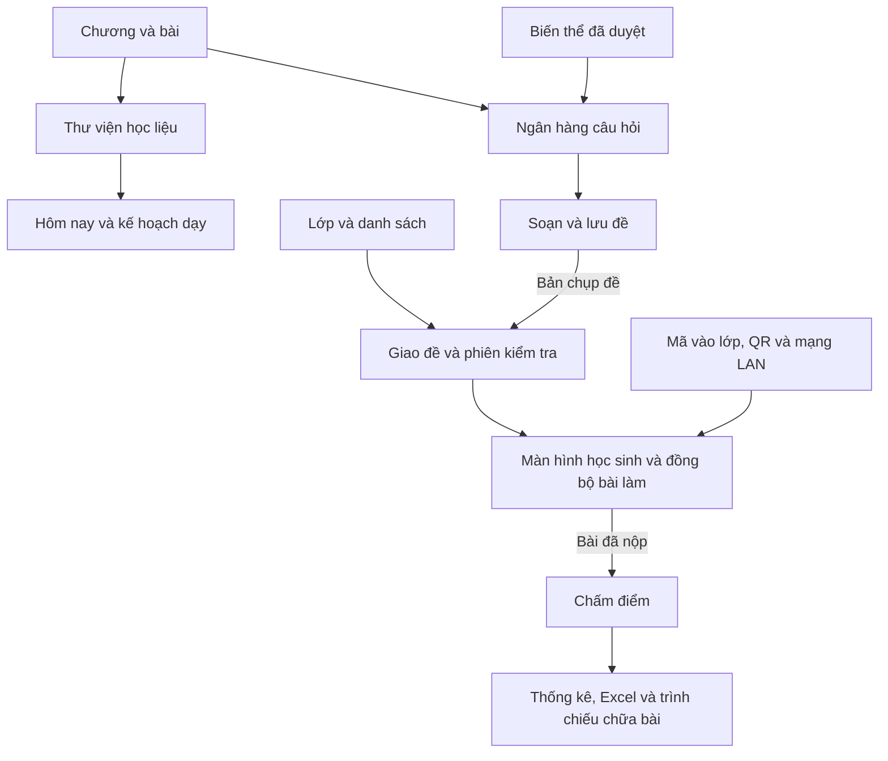
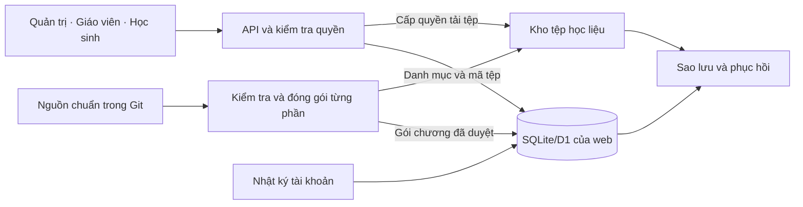
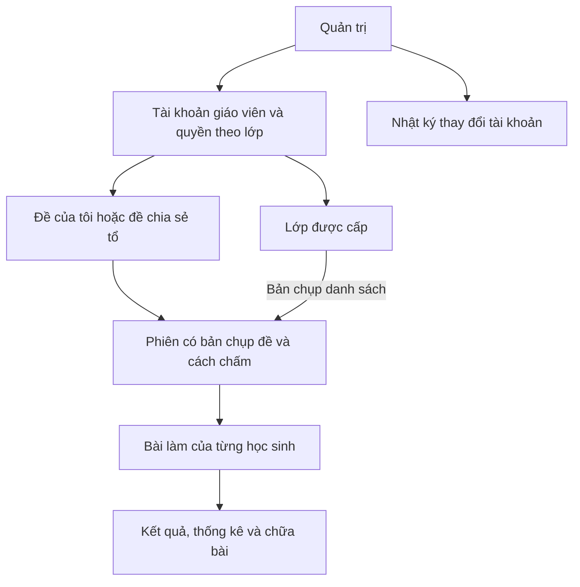
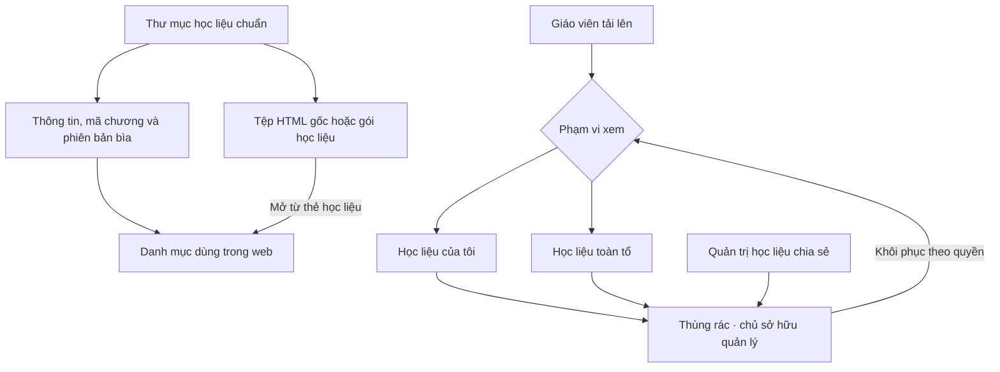
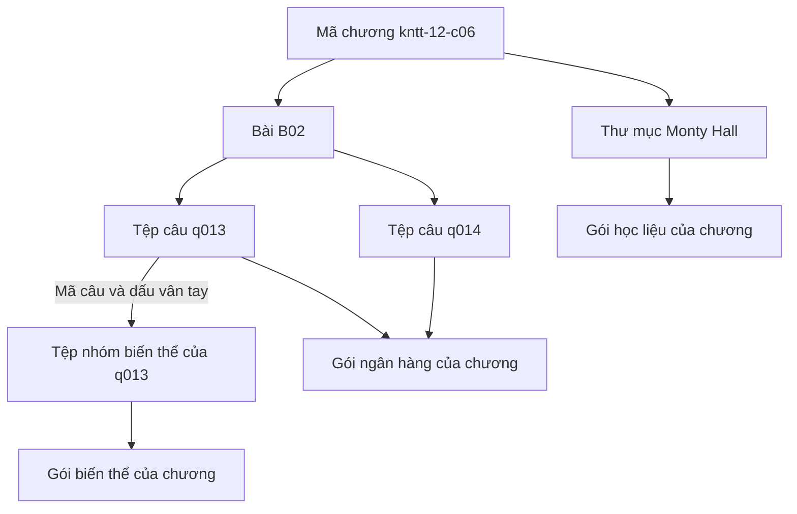
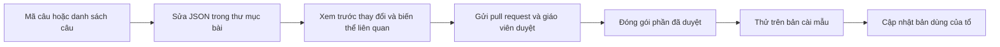

# Sơ đồ mô-đun Toán THĐ Studio

[Bản đồ tệp v0.14](#bản-đồ-tệp-v014) · [Cây thư mục](#cây-thư-mục) · [Tìm và sửa câu](#tìm-và-sửa-câu) · [Giao việc trên GitHub](#giao-việc-trên-github) · [Lộ trình](#lộ-trình)

V0.14 tổ chức dữ liệu chuẩn theo khối, chương và bài. Chương VI Toán 12 đã có **một tệp nguồn cho mỗi câu** và một tệp riêng cho nhóm biến thể của câu đó. Monty Hall có thư mục riêng cho thông tin học liệu và bìa. Các phần còn lại có vị trí tra cứu trong bản đồ bên dưới. Tên dưới `features/` và `server/` là cấu trúc đích khi tách mã ứng dụng.

## Các mô-đun nối với nhau thế nào

Các mũi tên chỉ dữ liệu chuyển giữa các mô-đun khi sử dụng web. Mô-đun dùng mã chương, mã học liệu, mã câu hoặc mã phiên để tìm đúng dữ liệu.



### Đóng gói và lưu trữ

Sơ đồ này thể hiện luồng đích. Học liệu chuẩn v0.14 được phục vụ từ `public/hoc-lieu-so/nguon/`. Tệp giáo viên tải lên hiện lưu trong SQLite cùng thông tin chia sẻ. Bước chuyển sang kho tệp riêng sẽ giữ nguyên đường dẫn truy cập qua API và quyền xem.



Đề đã lưu có bản chụp câu hỏi. Khi giao đề, phiên giữ danh sách học sinh, câu, đáp án và cách chấm tại thời điểm giao. Báo cáo và trình chiếu đọc kết quả từ phiên đó.

### Kế hoạch tiết dạy

Bảng `studio_plans` có một bản ghi cho mỗi cặp tài khoản và mã lớp. `resource_ids` là danh sách mã học liệu theo thứ tự trong tiết. API kiểm tra phạm vi lớp và quyền mở tệp. Hai trình duyệt thêm hai học liệu cùng lúc sẽ ghi từng thao tác vào kế hoạch đang lưu. [Migration](../drizzle/0007_studio_plans.sql) · [API kế hoạch](../lib/studio-plan.mjs) · [Hàm JSON của D1](https://developers.cloudflare.com/d1/sql-api/query-json/)

Trình duyệt cũ chuyển kế hoạch theo từng lớp chưa có bản ghi. Sau khi bỏ học liệu cuối cùng, bản ghi vẫn biểu thị một kế hoạch trống. Phục hồi JSON trong ứng dụng giữ kế hoạch của bản cài đích theo mã lớp. Sao lưu toàn thư mục giữ cả các kế hoạch đã đồng bộ. [Đọc và chuyển kế hoạch](../app/use-studio-plan.ts) · [Sao lưu toàn thư mục](../README.md#sao-lưu-toàn-bộ-thư-mục)

### Tài khoản, lớp và bài làm



### Học liệu chuẩn và học liệu giáo viên



Nếu quản trị đưa một học liệu chia sẻ vào thùng rác rồi giáo viên sở hữu khôi phục, v0.14 đưa học liệu đó về chế độ riêng tư. Giáo viên chọn chia sẻ lại khi đã sẵn sàng.

## Bản đồ tệp v0.14

Các đường dẫn ở cột giữa mở được từ thư mục gốc của bản nguồn. Khi giao việc, lấy hàng tương ứng và đính kèm mã câu, mã học liệu hoặc màn hình cần sửa.

| Mô-đun | Mở ở v0.14 | Phạm vi phụ trách |
| --- | --- | --- |
| Điều hướng và Hôm nay | `app/workspace.tsx`, `app/studio-navigation.tsx`, `app/studio-plan.tsx`, `app/studio.css` | Màn hình đầu, danh mục, tìm nhanh và giao diện kế hoạch của lớp. |
| Đồng bộ kế hoạch | `app/use-studio-plan.ts`, `lib/studio-plan.mjs`, `drizzle/0007_studio_plans.sql` | Đọc, thêm, bỏ học liệu và chuyển kế hoạch cũ theo tài khoản và lớp. |
| Chương, bài và đề cương | `data/curriculum/kntt-math.json`, `data/course-bank/manifest.json`, `app/admin-panels.tsx`, `lib/admin.mjs` | Mục lục chương theo khối, tài liệu, bài và phiên bản đề cương. |
| Ngân hàng chuẩn | `data/course-bank/src/12/C06/`, `lib/course-bank.mjs`, `scripts/course-bank-data.mjs` | Nguồn chuẩn, tra cứu, trạng thái duyệt, nhập gói vào web. |
| Biến thể | `data/chapter-variants/src/12/C06/`, `lib/accepted-variants.mjs`, `lib/question-variants.mjs` | Nhóm biến thể, điều kiện khả dụng và tra phiên bản câu gốc. |
| Giao diện ngân hàng và soạn đề | `app/workspace.tsx`, `app/studio-library-bank.css`, `app/admin-panels.tsx`, `lib/api.ts` | Bộ lọc, xem câu, giỏ câu, sửa ngân hàng nội bộ và chọn câu. |
| Học liệu chuẩn | `app/digital-library.tsx`, `app/hoc-lieu-so/page.tsx`, `app/studio-cover.tsx`, `lib/client/library-catalog.ts`, `data/digital-library/`, `public/hoc-lieu-so/nguon/` | Danh mục, bìa, tìm kiếm, mở học liệu và nhóm theo chương. |
| Học liệu giáo viên | `app/library-uploads.tsx`, `lib/library-uploads.mjs`, `drizzle/0005_library_uploads.sql` | Tải lên, riêng tư/chia sẻ tổ, cấp quyền mở tệp, thùng rác và khôi phục. |
| Tài khoản, quản trị và cài đặt | `app/staff-panels.tsx`, `app/staff.css`, `app/admin-panels.tsx`, `lib/accounts.mjs`, `lib/auth.mjs`, `lib/access.mjs` | Cấp tài khoản, đổi mật khẩu, quyền theo lớp và nhật ký. |
| Lớp và nhập danh sách | `app/admin-panels.tsx`, `lib/admin.mjs`, `lib/client/importers.mjs` | Tạo lớp, danh sách, nhập Excel/CSV và xem trước thay đổi. |
| Nhập nội dung và công thức | `lib/client/importers.mjs`, `lib/content.mjs`, `lib/rich-html.mjs`, `app/rich-content.tsx` | Đọc Word/Excel/JSON, xử lý MathML, LaTeX và hình. |
| Đề đã lưu | `app/staff-panels.tsx`, `lib/api.ts` (`teacher/exams`), `db/schema.ts` | Đề riêng/đề tổ, chủ sở hữu, bản chụp câu và giao đề. |
| Phiên kiểm tra | `app/workspace.tsx`, `lib/api.ts` (`teacher/sessions`, `teacher/session`), `db/schema.ts` | Giao đề cho lớp, mở/đóng/gia hạn phiên và giữ dữ liệu khi giao. |
| Học sinh và bài làm | `app/hoc-sinh/page.tsx`, `StudentApp` trong `app/workspace.tsx`, `lib/client/attempt-sync.mjs`, `lib/api.ts` (`public/*`) | Vào lớp, lưu nháp, đổi thiết bị, tự thử lại và nộp bài. |
| Chấm điểm | `lib/grading.mjs`, `lib/api.ts` (`teacher/grade-free` và `public/submit`) | Kiểm tra câu trả lời, chấm tự động và chấm tự luận. |
| Thống kê, Excel và chữa bài | `app/report-panels.tsx`, `app/thd-projector.tsx`, `public/thd-3.0/`, `lib/analytics.mjs`, `lib/client/report-export.mjs` | Báo cáo theo phiên, xuất Excel, xem bài và trình chiếu. |
| Kết nối và QR | `app/lan-panels.tsx`, `lib/share.mjs`, `scripts/lan-gateway.mjs`, `scripts/diagnose-network.mjs` | Chia sẻ mã/QR, kết nối thiết bị và quyền truy cập qua LAN. |
| Sao lưu và nâng cấp | `app/backup-panel.tsx`, `lib/backup-model.mjs`, `lib/backup-service.mjs`, `scripts/snapshot-local.mjs`, `scripts/upgrade-local.mjs` | Xuất, đối chiếu, khôi phục và chuyển bản cài. |
| Nền tảng và phát hành | `app/api/[...path]/route.ts`, `lib/api.ts`, `db/`, `drizzle/`, `worker/`, `scripts/`, `tests/`, `.github/` | Điểm vào web/API, cấu hình chạy, cơ sở dữ liệu, bộ kiểm tra và đóng gói. |

Trình sửa câu trên web ghi vào tài liệu của bản cài. Với đề cương chuẩn đã tích hợp, quy trình duyệt và sửa nguồn đi qua các tệp JSON và gói phát hành.

## Cây thư mục

Giữ các lối vào web trong `app/`. Khi tách, mỗi nhóm giao diện có thư mục trong `features/`, còn nghiệp vụ và thao tác database đi qua `server/`. `components/ui/` tiếp tục giữ thành phần dùng chung. Chia phần theo trách nhiệm để một người chỉnh bộ lọc ngân hàng và một người chỉnh giao diện học liệu có thể làm trên hai nhánh.

```text
ToanTHD/
├── app/                         # Điểm vào giao diện và /api
├── features/                    # Cấu trúc đích cho giao diện từng chức năng
│   ├── studio/                  # Điều hướng, Hôm nay, kế hoạch
│   ├── library/                 # Danh mục, bìa, tải lên
│   ├── bank/                    # Tìm, xem, sửa và chọn câu
│   ├── exams/                   # Soạn đề, lưu đề, quyền chia sẻ
│   ├── classrooms/              # Lớp, học sinh, nhập danh sách
│   ├── sessions/                # Mở phiên, giao đề và giám sát
│   ├── student/                 # Vào lớp, lưu bài và nộp bài
│   ├── reports/                 # Thống kê, Excel, trình chiếu
│   ├── staff/                   # Tài khoản, quyền, cài đặt
│   └── operations/              # Kết nối, QR, sao lưu
├── server/                      # Cấu trúc đích cho nghiệp vụ và dữ liệu
│   ├── accounts/                # Xác thực, cấp quyền, nhật ký
│   ├── catalog/                 # Chương, bài và mã dùng chung
│   ├── bank/                    # Ngân hàng, biến thể, nhập nguồn
│   ├── library/                 # Danh mục, tải tệp, quyền xem
│   ├── classrooms/              # Danh sách lớp và nhập học sinh
│   ├── exams/                   # Đề và bản chụp câu hỏi
│   ├── sessions/                # Phiên, bài làm và chấm
│   ├── reports/                 # Tổng hợp theo phiên
│   └── backup/                  # Kiểm tra và phục hồi bản sao lưu
├── components/ui/               # Nút, hộp thoại, biểu mẫu dùng chung
├── db/                          # Kiểu dữ liệu và kết nối SQLite/D1
├── drizzle/                     # Thay đổi database theo thứ tự
├── data/                        # Nguồn chuẩn và gói do công cụ sinh
├── public/                      # Tệp web công khai đã chọn
├── scripts/                     # Kiểm tra, đóng gói, cài đặt và LAN
├── tests/                       # Kiểm thử theo phần, dữ liệu giả lập
├── docs/                        # Sơ đồ, hướng dẫn và lộ trình
└── .github/                     # Mẫu pull request, người duyệt, kiểm tra tự động
```

Khi tách một chức năng, ghi rõ điểm vào, nơi lưu dữ liệu và phần kiểm thử của chức năng đó. Ví dụ `features/bank/` sở hữu bộ lọc, danh sách và bộ chọn câu, `server/bank/` xử lý truy vấn và lấy biến thể đúng phiên bản. Đề nhận câu đã chọn rồi tạo bản chụp. Thư viện và ngân hàng cùng đọc mục lục từ `server/catalog/`.

| Thay đổi cần giao | Kết nối giữa các mô-đun cần giữ |
| --- | --- |
| Đổi bộ lọc hoặc giao diện chọn câu | Ngân hàng nhận mã chương, bài và bộ lọc. Đề nhận mã câu hoặc mã biến thể và nội dung để tạo bản chụp. |
| Đổi thẻ, ảnh bìa hoặc trình mở học liệu | Thư viện nhận mã học liệu và trả thông tin hiển thị. Khi mở tệp, API kiểm tra quyền theo tài khoản và phạm vi chia sẻ. |
| Chỉnh màn hình làm bài | Màn hình học sinh dùng mã phiên và mã bài làm. Lưu nháp gửi câu trả lời kèm phiên bản lưu. Nộp bài đi qua quy trình chấm dùng chung. |
| Chỉnh báo cáo hoặc mẫu Excel | Báo cáo nhận một phiên đã ghi dữ liệu. Cả màn hình, Excel và trình chiếu dùng cùng cách diễn giải bản chụp câu hỏi và kết quả. |
| Chỉnh phân quyền | Tài khoản trả quyền theo hành động và lớp. Các API vẫn kiểm tra quyền ở máy chủ, kể cả khi giao diện đổi vị trí nút. |

### Phần dữ liệu có thể giao ngay

```text
data/
├── curriculum/
│   └── kntt-math.json
├── course-bank/
│   ├── src/12/C06/
│   │   ├── B01/                 # 48 câu Xác suất có điều kiện
│   │   └── B02/                 # 70 câu Xác suất toàn phần và Bayes
│   │       ├── dc-12-hk2-6D2-q013-v4.json
│   │       └── dc-12-hk2-6D2-q014-v4.json
│   ├── generated/12-C06.json   # Gói do lệnh build tạo
│   └── questions.json.gz       # Ngân hàng nền của v0.14
├── chapter-variants/
│   ├── src/12/C06/B02/
│   │   └── dc-12-hk2-6D2-q013-v4.json
│   ├── generated/12-C06.json   # Gói do lệnh build tạo
│   └── source/                 # Gói nguồn các chương đã nghiệm thu
└── digital-library/
    ├── src/12/C06/12-monty-hall-game-577dcd0/
    │   ├── manifest.json        # Tên, mô tả, chương, mã kiểm tra HTML
    │   └── cover.jpg            # Ảnh bìa
    └── generated/monty-hall.json
```

Đường dẫn `12/C06/B02/` cho biết khối, chương và bài. Mã `dc-12-hk2-6D2-q013-v4` xác định câu 13 của đúng đề cương và bài. Đổi tiêu đề bài hoặc lời giải vẫn dùng cùng mã. `v4` trong mã thuộc phiên bản đề cương gốc. Phiên bản sửa câu và phiên bản gói được theo dõi riêng. Mỗi câu giữ chung đề, phương án, đáp án và lời giải để một người duyệt đủ ngữ cảnh. Tệp biến thể cùng mã chứa nhóm tối đa bốn biến thể của câu đó.

Nguồn các câu ở chương khác hiện nằm trong `data/course-bank/questions.json.gz`. Danh mục bài và tài liệu nằm trong `data/course-bank/manifest.json`. Các gói biến thể đã nghiệm thu của Chương I–V nằm trong `data/chapter-variants/source/12-C01.json.gz` đến `12-C05.json.gz`, có thông tin bàn giao trong `data/chapter-variants/release.json`.



## Tìm và sửa câu

1. **Một câu.** Mở [câu 13 bài Bayes](../data/course-bank/src/12/C06/B02/dc-12-hk2-6D2-q013-v4.json) và sửa trường được giao, ví dụ `solution`. Có thể tìm bằng tên tệp trong trình soạn thảo, hoặc mở đúng đường dẫn từ yêu cầu trên GitHub. Giữ `id`, `original_number`, `kind`, `based_on` và định dạng HTML/MathML đang dùng. Nếu sửa đáp án, đối chiếu cả lời giải và `accepted_answers` với dạng trả lời ngắn.
2. **Một bài hoặc một phần của bài.** Giao thư mục `B02/` kèm danh sách mã câu, ví dụ q013–q020 hoặc các câu có `kind: "tf"`. Người sửa cùng bài có thể dùng nhánh riêng cho từng nhóm câu. Phạm vi thử nghiệm hiện là chỉnh nội dung của các mã đã có. Đổi dạng hoặc bổ sung mã mới cần mở rộng bộ nhập nguồn chuẩn.
3. **Biến thể và học liệu.** Mở [tệp biến thể của câu 13](../data/chapter-variants/src/12/C06/B02/dc-12-hk2-6D2-q013-v4.json) khi được giao soát các biến thể. Thay bìa Monty Hall tại `cover.jpg` và chạy lệnh build của `library`. Mã và dấu vân tay tệp HTML gốc vẫn được dùng để tìm đúng học liệu.
4. **Kiểm tra và giao lại.** Chạy các lệnh ở [hướng dẫn đóng góp](../CONTRIBUTING.md). Bản xem trước liệt kê mã câu đã đổi, dấu vân tay mới và nhóm biến thể cần duyệt. Một câu gốc thay nội dung có thể làm các biến thể gắn bản trước tạm ẩn khi soạn đề mới. Đưa lại biến thể sau khi người duyệt đối chiếu và cập nhật `source_fingerprint`.



## Giao việc trên GitHub

| Người được giao | Ví dụ yêu cầu | Người duyệt |
| --- | --- | --- |
| Giáo viên hoặc AI sửa lời giải | Câu `dc-12-hk2-6D2-q013-v4`, sửa `solution`, đối chiếu công thức Bayes và ghi nhóm biến thể liên quan | Giáo viên phụ trách Toán 12 |
| Nhóm phụ trách một phần | `12/C06/B02`, chỉ các câu Đúng/Sai, kiểm tra bốn ý và đáp án từng ý | Trưởng nhóm nội dung khối 12 |
| Người phụ trách học liệu | `12-monty-hall-game-577dcd0`, sửa ảnh bìa và xem thử thẻ học liệu | Người phụ trách thư viện |
| Người sửa chức năng | Giao diện bộ chọn câu, kèm ảnh hoặc bước thao tác hiện tại, chạy kiểm thử ngân hàng và lưu đề | Người bảo trì web |

Ghi đường dẫn, mã hoặc phạm vi, thay đổi cần làm và cách nghiệm thu trong yêu cầu. Một nhánh cho một việc. Khi nhánh chính đã có sửa đổi của người khác, ghép phần nguồn theo từng tệp rồi sinh lại gói chung của chương. Kết quả sinh ra thuộc cùng pull request trong quy trình v0.14.

Dùng [mẫu CODEOWNERS](../.github/CODEOWNERS.example) để định tuyến người duyệt theo khối, mô-đun và đường dẫn. Thay tên mẫu bằng tài khoản thật có quyền ghi. Bật duyệt và kiểm tra tự động trên `main` nếu kho hỗ trợ. `CODEOWNERS` điều phối duyệt, còn GitHub cấp quyền đọc và ghi theo kho. Nếu một người chỉ được xem một chương, giao qua kho riêng của chương hoặc qua gói nội dung được cấp quyền. [CODEOWNERS](https://docs.github.com/en/repositories/managing-your-repositorys-settings-and-features/customizing-your-repository/about-code-owners) · [Quyền theo kho](https://docs.github.com/en/organizations/managing-user-access-to-your-organizations-repositories/managing-repository-roles/repository-roles-for-an-organization) · [Quy tắc nhánh](https://docs.github.com/en/repositories/configuring-branches-and-merges-in-your-repository/managing-rulesets/available-rules-for-rulesets#require-a-pull-request-before-merging)

Khi công bố mã nguồn, kho **công khai** có thể chứa phần mã được phép chia sẻ, dữ liệu minh họa và tài liệu đóng góp. Chọn giấy phép cho phần mã đó. Giữ ngân hàng kèm đáp án và các học liệu giới hạn chia sẻ trong kho **riêng của tổ** hoặc kho phát hành có kiểm soát quyền truy cập. Bản cài vận hành giữ `.dev.vars`, SQLite, danh sách thật, đề riêng, bài làm, học liệu cá nhân và bản sao lưu. Tạo bản công khai từ nguồn đã kiểm tra cả tệp gốc lẫn tệp sinh ra, gồm dữ liệu nén, hình, bản build và lịch sử Git. [Giấy phép kho mã](https://docs.github.com/en/repositories/managing-your-repositorys-settings-and-features/customizing-your-repository/licensing-a-repository)

Trước khi tách kho công khai, đưa các tệp ngân hàng đóng gói, chỉ mục câu, mô-đun biến thể và danh mục học liệu về cùng bước nạp nội dung. Bản công khai nạp gói mẫu. Bản dùng trong tổ nạp gói đã duyệt tương ứng với cùng định dạng. Kiểm thử cài mới từ cả hai kho trên database trống.

## Lộ trình

| Việc | Tiêu chí nghiệm thu |
| --- | --- |
| Mở rộng nguồn theo từng câu sang Chương I–V, sau đó tới khối 10–11 | Ánh xạ 75 bài trong ngân hàng vào mã chương đã kiểm tra. Mở nguồn theo từng chương. Đối chiếu mã, loại, trạng thái, câu hỏi, đáp án, hình và dấu vân tay với gói đã duyệt. Toàn ngân hàng nền hiện có 5.837 câu. |
| Chuẩn hóa gói theo phần và mã chương | Dùng mã chương chung như `kntt-12-c06`. Kiểm tra gói đúng chương, nhập lại cho cùng kết quả, xem trước và quay về gói trước. Khi ghép gói mới, đối chiếu đề và bài làm cũ. |
| Tách mã ứng dụng theo nhóm | Bắt đầu từ bộ chọn câu và thư viện. Giữ điểm vào web/API đang dùng, tách dần theo màn hình và kiểm tra lưu đề, tải học liệu, cấp quyền. |
| Tạo bản nguồn công khai khi có phạm vi chia sẻ | Bản mã công khai chạy được với dữ liệu mẫu. Bản dùng trong tổ nạp riêng gói nội dung được duyệt. |

Sơ đồ Mermaid được lưu dưới dạng văn bản trong chính tài liệu này để người bảo trì sửa cùng mã nguồn. [Cách xem sơ đồ trên GitHub](https://docs.github.com/en/get-started/writing-on-github/working-with-advanced-formatting/creating-diagrams)
